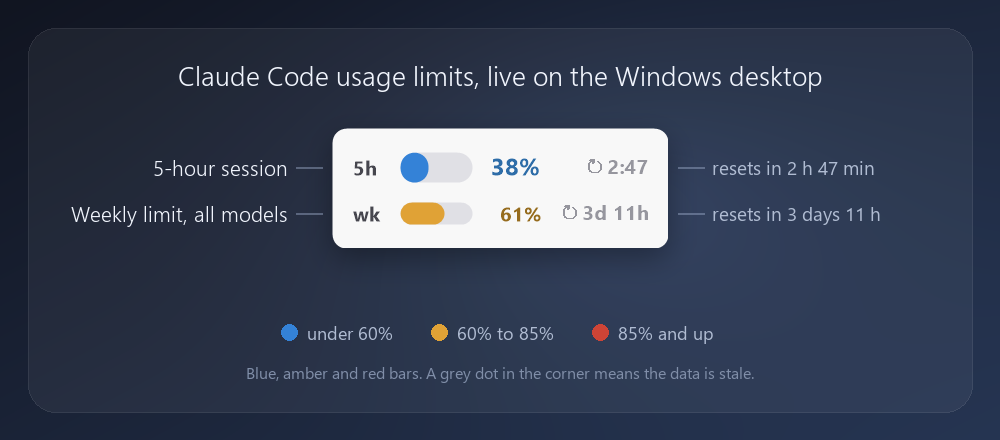
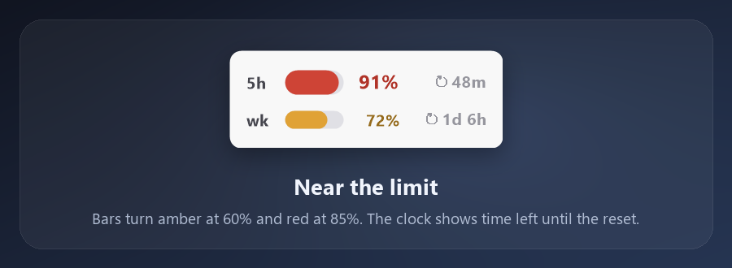
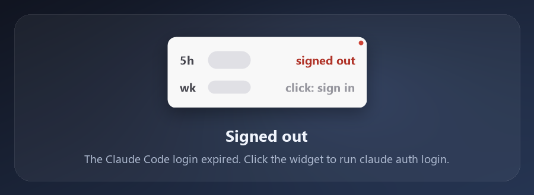
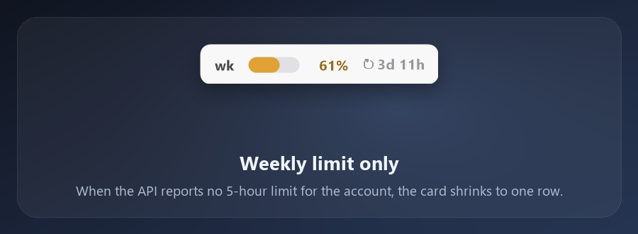

# Claude Usage Widget for Windows

Claude Usage Widget is a small desktop widget for Windows 10 and Windows 11 that shows your Claude Code usage limits at a glance: the 5-hour limit and the weekly limit, each with a bar, the percent used and a countdown to its reset. When the API reports no 5-hour limit for your account, you get the weekly limit alone in a smaller card. It works as a rate limit monitor for people on a Claude subscription such as Pro or Max, so you can see how close you are to a limit without opening the usage page. It runs as plain PowerShell, sits below all your windows, and needs no installer and no admin rights.

> Not affiliated with or endorsed by Anthropic. Claude and Claude Code are trademarks of Anthropic. This is an independent project. It reads an undocumented endpoint, so it can stop working whenever that endpoint changes. See [Privacy](#privacy) for exactly what it reads and sends.

## Features

- Two rows: the current 5-hour session (large) and the weekly limit across all models (small). When the API reports no 5-hour limit for your account, the 5-hour row goes away and the card shrinks to the weekly row. It comes back by itself if the API reports the limit again.
- Bars change color with use: blue below 60%, amber from 60%, red from 85%.
- Time until each reset: `2:47` or `48m` for the session, `3d 11h` or `5h` for the week.
- At 100% the percentage is replaced by a red countdown to the reset.
- A small dot in the top-right corner tells you about the data: red means signed out or token problem, amber means a network or rate-limit error (the last good numbers stay on screen), grey means the data is more than 8 minutes old. No dot means fresh and healthy.
- When your Claude Code login has expired, the widget says so and one click opens the sign-in.
- Polls slowly on purpose (about every 2 minutes while you work, less when idle), because the endpoint rate-limits.
- Scales with Windows display scaling: the layout is drawn in design pixels and looks the same at 100%, 125%, 150%, 175% and 200%. The scale is read when the widget starts, so restart the widget after you change the setting.
- When the API sends no reset time yet (a new account, or an idle 5-hour window), the bar is shown without a countdown.
- Sits below all windows, stays out of the taskbar and Alt-Tab, never takes focus, remembers its position.
- One file of about 790 lines of PowerShell. Easy to read before you run it.

## States

Near the limit, the bars go amber and then red:

At 100% the percentage turns into a countdown to the reset:

When the Claude Code login has expired the widget stops polling and offers the sign-in on click:

On an account with no 5-hour limit, the card shows the weekly row only:

## Requirements

- Windows 10 or 11, Windows PowerShell 5.1 (built in). No admin rights, nothing to install.
- The Claude Code CLI, installed and signed in with a Claude subscription account such as Pro or Max. The widget uses the login that Claude Code already stores on your PC. An API key alone does not provide this data.

## Install

1. Download the latest ZIP from [Releases](https://github.com/datonko-gi/claude-usage-widget/releases) and unzip it, or run `git clone https://github.com/datonko-gi/claude-usage-widget.git`.
2. Make sure Claude Code works: run `claude` once in a terminal and sign in if it asks.
3. Double-click `install.bat`. It adds a shortcut to your Startup folder and starts the widget in the bottom-right corner of the primary screen.

Keep the folder where it is: the Startup shortcut points to it. The widget starts on every login.

## Usage

- **Left-click** refreshes now. Manual refreshes are limited to one per minute so the widget cannot hammer the endpoint.
- **Left-click while signed out** opens a terminal that runs `claude auth login`. Finish the login in the browser; the widget notices the new login within seconds.
- **Drag** to move it. The position is saved.
- **Right-click** opens the menu: Refresh now, Open usage page (claude.ai/settings/usage in your browser), Sign in to Claude CLI, Close widget.
- The widget is below all windows. To see it, show the desktop with Win+D. To quit it, use right-click then Close widget.

## Configuration and data

There is no settings file. Everything the widget writes lives in `%APPDATA%\ClaudeUsage\`:

| file | content |
| --- | --- |
| `data.json` | window position |
| `usage_cache.json` | last good percentages and reset times, so the first paint is not empty |
| `widget.log` | status and error messages (trimmed when it grows past 200 KB) |

To change colors, thresholds or polling, edit `claude_usage.ps1`: `Bar-Color` and `Text-Color` hold the 60% and 85% thresholds, and the timer block holds the polling intervals. Please keep the intervals slow. The environment variable `CLAUDEUSAGE_LOGDIR` moves the data folder.

## How it works

- Once a second a timer repaints the countdowns. The network request runs in a background runspace, so the widget never freezes on a slow connection.
- The request is `GET https://api.anthropic.com/api/oauth/usage` with the headers `Authorization: Bearer <access token>` and `anthropic-beta: oauth-2025-04-20`. The widget reads the `limits[]` array (kinds `session` and `weekly_all`) and falls back to `five_hour` or `seven_day` when the array has no number for that limit. No `session` entry and a null `five_hour` mean the account has no 5-hour limit. A null `resets_at` means no countdown.
- Cadence: every 2 minutes while you are at the PC, every 5 minutes after 10 minutes idle, every 10 minutes after an hour idle. After a failure it backs off 5, 10, 20, then 30 minutes. It also refetches when the PC wakes from sleep, shortly after a reset time passes, and when the credentials file changes.
- The access token lasts a few hours and Claude Code refreshes it when you use it. If the widget gets a 401 while a refresh token still exists, it starts `claude -p --model haiku OK` hidden, at most once every 15 minutes, so the CLI refreshes and saves its own token. The widget never writes the credentials file. That call is a real, tiny request and counts toward your usage.
- The Claude Code login expires after about a month. Then the CLI wipes its tokens and the widget shows "signed out". It stops polling (one slow check every 10 minutes at most) and picks up the new login as soon as the credentials file changes.
- The window is a borderless WinForms form with the `WS_EX_NOACTIVATE` and `WS_EX_TOOLWINDOW` styles, pushed to the bottom of the z-order and sunk again whenever something raises it. Rounded corners come from a window region.
- Display scaling: all drawing is done in design pixels (168 by 60 at 100%). The form size, the fonts and the Graphics are multiplied by the system DPI divided by 96, so nothing is laid out in fixed physical pixels.
- One-row layout: the form keeps its full size and only the window region shrinks to the lower 28 design pixels, so the bottom edge stays put and the empty part lets clicks through. Windows will not make a window this short (it clamps the height to `SM_CYMINTRACK`), so `GetWindowRect` still reports the full height. Check the visible height with `GetWindowRgnBox`.
- Single instance: a second launch checks for a running widget and a named mutex, then exits.

## Privacy

- **Reads:** `%USERPROFILE%\.claude\.credentials.json`, read-only. From it the widget takes the OAuth access token, whether a refresh token exists, and when that refresh token expires. It never writes, copies or logs the token.
- **Sends:** the access token goes in an HTTPS `Authorization` header to `https://api.anthropic.com/api/oauth/usage`, and nowhere else. There is no telemetry, no analytics and no other server.
- **Stores:** only `data.json`, `usage_cache.json` and `widget.log` in `%APPDATA%\ClaudeUsage`, holding percentages, reset times, the window position and log lines. No token is stored.
- **Starts other programs only on request or for the token refresh:** `claude` (the refresh described above, and `claude auth login` when you click to sign in), and your default browser for Open usage page.
- **Terms of use:** the widget uses your own Claude Code login token with an endpoint that Anthropic does not document for third-party use, which Anthropic may consider outside its terms, so use it at your own risk.
- **Unofficial:** the endpoint is undocumented and may change or disappear, and it returns 429 when polled too often. This project has no connection to Anthropic, and the author cannot promise it keeps working. Read the script, it is one file.

## Uninstall

Run `uninstall.bat`. It removes the Startup shortcut and stops the widget. Then delete the folder and, if you like, `%APPDATA%\ClaudeUsage`.

## Troubleshooting

- **The widget says "signed out".** The Claude Code login has expired (it lasts about a month) or Claude Code is not signed in with a Claude account. Click the widget, finish `claude auth login` in the browser, and the numbers come back on their own.
- **Clicking "click: sign in" does nothing.** The widget looks for `%USERPROFILE%\.local\bin\claude.exe` and then for `claude` on your PATH. If neither exists, `widget.log` says `claude.exe not found`. Install Claude Code or add it to PATH, then restart the widget.
- **Amber dot, numbers not moving.** The endpoint answered 429 or the network is down. The widget keeps the last good numbers and backs off for 5 to 30 minutes. `widget.log` has the reason. Avoid clicking repeatedly while the dot is amber: a manual refresh still goes out once a minute during the backoff, which can prolong a rate limit.
- **A bar without a countdown.** The API sent no reset time for that limit, which happens on a new account or while no 5-hour window is running. The percentage is still shown. The countdown appears as soon as the API reports a reset time.
- **The 5-hour row is gone.** The API reports no 5-hour limit for your account. The card shows the weekly limit alone. While signed out it goes back to two rows, because that state has two messages to show.

## More widgets

More Windows desktop widgets in PowerShell, plus a guide to building your own, in [windows-desktop-widgets](https://github.com/datonko-gi/windows-desktop-widgets). Also: [habit-tracker-widget](https://github.com/datonko-gi/habit-tracker-widget) and [volume-mic-widget](https://github.com/datonko-gi/volume-mic-widget).

## License

MIT. See [LICENSE](LICENSE).
